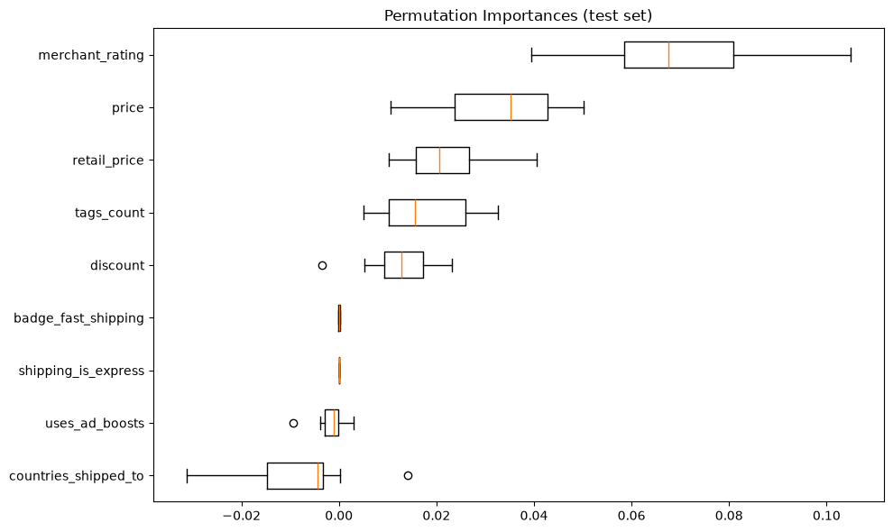

# O que faz um produto vender bem no Wish?

Análise de 1.341 produtos de moda de verão do marketplace Wish para entender quais fatores estão ligados ao sucesso de vendas. O objetivo é orientar uma empresa que quer começar a revender produtos na plataforma.

## Resumo

- **A reputação do vendedor é o fator mais consistente:** produtos de sucesso vêm de vendedores com nota maior, e essa é a variável mais importante do modelo.
- **Desconto, ad boost e frete não estão ligados a mais vendas.** Produtos de sucesso têm até desconto *menor*.
- **As tags mais usadas são as mesmas nos dois grupos.** A categoria (moda feminina de verão) domina a base inteira.
- **Com só as variáveis disponíveis antes da venda, um modelo prevê pouco** (ROC AUC de 0,66 no teste). Preço e configuração do anúncio explicam pouco do sucesso.

## Problema

Uma empresa quer revender produtos no Wish e precisa saber onde investir: em quais produtos e em quais recursos de anúncio (desconto, impulsionamento pago, tags, frete).

**Definição de sucesso:** produto com **1.000 unidades vendidas ou mais** (a mediana da base). O critério usa unidades vendidas, e não faturamento, para que o preço não faça parte da definição do sucesso.

## Dados

[Sales of summer clothes in E-commerce Wish](https://www.kaggle.com/datasets/jmmvutu/summer-products-and-sales-in-ecommerce-wish), de Jeffrey Mvutu Mabilama (licença CC BY 4.0). São os produtos que apareciam na busca por "summer" no Wish em agosto de 2020. Os preços estão em euros.

**Tratamentos:**
- **Duplicatas:** 232 linhas eram o mesmo produto coletado duas vezes e foram removidas (1.573 → 1.341 produtos).
- **Nota padrão:** 35 produtos sem nenhuma avaliação apareciam com nota 5,0. A nota deles foi tratada como ausente.
- **Valores ausentes:** os do banner de urgência foram tratados como "sem banner".

## Etapas

1. Análise da qualidade dos dados
2. Análise exploratória por pergunta de negócio, com teste estatístico em cada uma (Mann-Whitney para variáveis numéricas e qui-quadrado para sim/não)
3. Modelo Random Forest (`RandomizedSearchCV` + `StratifiedKFold`) usando só variáveis disponíveis antes da venda
4. Importância das variáveis com permutation importance

## Resultados

### Perguntas de negócio

| Pergunta | Resultado | Resposta |
|---|---|---|
| Desconto (retail vs. price) aumenta vendas? | Mediana de 0 € nos produtos de sucesso vs. 1,65 € nos demais (p = 0,01) | **Não.** O desconto é até menor nos produtos de sucesso |
| Ad boost aumenta vendas? | Taxa de sucesso de 62,7% com vs. 63,5% sem (p = 0,79) | **Não há diferença** |
| Avaliações melhores aumentam vendas? | Nota mediana de 3,88 vs. 3,78 (p = 0,004) | **Diferença pequena**, e a nota também é consequência das vendas |
| Badges importam? | Badge de qualidade: 81,7% de sucesso com vs. 61,6% sem (p < 0,001) | **Acompanha o sucesso**, mas o badge depende das avaliações. O de envio rápido tem só 19 produtos |
| Quantidade de tags ajuda? | Mediana de 17 tags nos dois grupos | **Efeito pequeno** |
| Tags com maiores vendas? | Mesmas tags no topo dos dois grupos | **Não há nicho distinto** |
| Frete importa? | Mesma mediana de países atendidos (40); só 4 produtos com frete expresso | **Não** |
| Reputação do vendedor importa? | Nota mediana do vendedor de 4,07 vs. 4,01 (p < 0,001) | **Sim**, é o fator mais consistente |

### Modelo

O modelo usa só variáveis que existem **antes** da venda: preço, preço de retail, desconto, ad boost, badge de envio rápido, frete, países atendidos, quantidade de tags e nota do vendedor. Nota do produto, badge de qualidade, estoque e banner de urgência ficaram de fora porque dependem das vendas ou das avaliações.

| Métrica | Valor |
|---|---|
| ROC AUC (cross-validation) | 0,64 |
| ROC AUC (teste) | 0,66 |
| Acurácia (teste) | 67% (chutar sempre "sucesso" daria 63%) |



O modelo prevê pouco: as variáveis do anúncio explicam pouco do sucesso de um produto. A nota do vendedor é a variável mais importante, seguida de preço, preço de retail, quantidade de tags e desconto. Ad boost e frete praticamente não contribuem.

## Recomendações

1. **Cuidar da reputação desde o início:** escolher bem os fornecedores e caprichar nos primeiros pedidos para acumular boas avaliações.
2. **Não contar com ad boost, desconto ou frete como alavancas principais.** Se forem usados, testar (A/B) antes de investir mais.
3. **Não esperar que preço e configuração do anúncio garantam sucesso.**

## Limitações

- O sucesso é definido por um corte (1.000 unidades). Outros cortes poderiam mudar algumas conclusões.
- Um único recorte: busca "summer" em agosto de 2020.
- As vendas são acumuladas e não há data de lançamento, então produtos mais antigos tiveram mais tempo para vender.
- A nota do vendedor é medida depois das vendas e inclui as avaliações do próprio produto.
- Associação não é causa: as recomendações são hipóteses a validar com testes.

## Como executar

```bash
git clone https://github.com/fernandofigueiredo-data/wish-product-success-analysis.git
cd wish-product-success-analysis
python -m venv .venv
source .venv/bin/activate
pip install -r requirements.txt
```

Depois abra o notebook `notebooks/analise_de_vendas_wish.ipynb` e execute todas as células.

## Estrutura

```
├── data/
│   └── summer-products-with-rating-and-performance_2020-08.csv
├── notebooks/
│   └── analise_de_vendas_wish.ipynb
├── reports/figures/      # gráficos usados neste README
├── requirements.txt
└── README.md
```

**Ferramentas:** Python, pandas, matplotlib, seaborn, SciPy, scikit-learn, SHAP, WordCloud.

**Dados:** "Sales of summer clothes in E-commerce Wish", de Jeffrey Mvutu Mabilama, licenciado sob CC BY 4.0.
